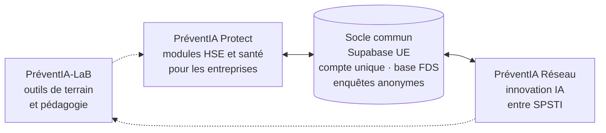
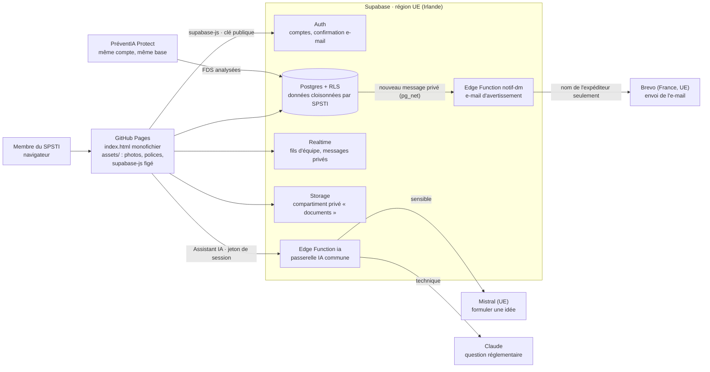

# PréventIA Réseau

> Laboratoire collaboratif d'innovation IA des Services de Prévention et de Santé au Travail Interentreprises (SPSTI).
> Pilote : **SPSTI 23/87** (Creuse · Haute-Vienne), conçu pour s'ouvrir ensuite à d'autres SPSTI.

**L'IA est un moyen, jamais une fin.** On part d'un besoin du terrain, on teste, on mesure, puis on décide, et la décision reste toujours humaine.

🔗 Site : <https://laurebonnefond.github.io/laurebonnefond-preventia-reseau/>
🧪 Démo sans compte : bouton **« Explorer la démo »** (données fictives, rien n'est enregistré)

### Dans l'écosystème PréventIA

PréventIA Réseau est l'une des trois plateformes PréventIA, au même niveau et reliées entre elles. Elle partage avec **PréventIA Protect** le même compte et la même base de données.



- **Un seul compte** : une personne connectée sur PréventIA Réseau l'est aussi sur PréventIA Protect, et inversement (les deux sites sont servis depuis `laurebonnefond.github.io`). Le SPSTI choisi est le même.
- **La base FDS** se remplit depuis le module Risque chimique de PréventIA Protect et se consulte, se vérifie et se partage ici.

---

## Sommaire

1. [Fonctionnalités](#fonctionnalités)
2. [Architecture](#architecture)
3. [Installation](#installation)
4. [Rôles et droits](#rôles-et-droits)
5. [Sécurité et données](#sécurité-et-données)
6. [Images du portail](#images-du-portail)
7. [Structure du dépôt](#structure-du-dépôt)
8. [Feuille de route](#feuille-de-route)

---

## Fonctionnalités

| Rubrique | Ce qu'on y fait |
|---|---|
| 🏠 **Accueil personnel** | Tableau de bord individuel (mes idées, soutiens reçus, tests suivis, temps gagné visé), activité sur 8 semaines, **parcours IA en 5 niveaux**, tuiles d'accès rapide, défi du moment |
| 💡 **Idées** | Déposer une problématique terrain en 2 minutes, sans vocabulaire technique ; soutiens « ça m'intéresse » / « je veux tester » ; commentaires |
| 🧪 **Expérimentations** | Fiche projet en 12 points (hypothèse, protocole, résultats, limites, décision), journal des testeurs, indicateurs estimés **et** mesurés |
| 🧰 **Boîte à outils** | Bibliothèque de prompts copiables, catalogue d'outils IA avec niveau de maturité |
| 💬 **Échanges & équipes** | Fil général du SPSTI, équipes **ouvertes ou sur invitation** auxquelles on rattache idées, tests et documents, **messages privés 1:1** en temps réel, avec pastille de messages non lus et **avertissement par e-mail** (sans le contenu, désactivable) |
| 📁 **Base documentaire** | Dépôt de procédures, modèles vierges et supports, protégés par SPSTI ; partage réseau validé |
| 🧪 **Base FDS** | Fiches de données de sécurité analysées dans PréventIA Protect : consulter, **marquer vérifiée**, **partager au réseau**, repérer celles à revoir (plus de 3 ans, ancien format, date inconnue) et celles avec une mention CMR. Seul le contenu des FDS est stocké, jamais de donnée d'entreprise ni de salarié |
| 👥 **Communauté** | Appels à volontaires, défis collectifs, annuaire du SPSTI, **groupes thématiques inter-SPSTI**, vue d'ensemble du réseau |
| 🔁 **Reproduire** | Reprendre dans son SPSTI le cadre d'un test partagé par un autre ; le SPSTI d'origine voit combien de fois il a été repris |
| 🔎 **Recherche** | Une seule recherche sur les idées, tests, prompts et documents ; idées proches signalées pendant la saisie |
| 📊 **Tableau de bord du SPSTI** | Indicateurs collectifs (jamais de classement individuel), entonnoir des idées, temps gagné |
| 🛡️ **Administration** | Code d'adhésion, rôles, validation des partages réseau, journal des actions sensibles |
| 🤖 **Assistant IA** | **Formuler une idée** (Mistral, UE) : l'assistant propose titre, problème, piste et questions, puis pré-remplit la Boîte à idées. **Question réglementaire** générale (Claude), avec les textes à vérifier. Mention « vous échangez avec une IA », contrôle 🔴 avant envoi, rien n'est enregistré |

### Le cycle d'une idée

```
 Problème ──► Idée ──► Test ──► Bilan ──► Partagé
 (terrain)   (2 min)  (volontaires) (mesure + décision) (réseau des SPSTI)
```

Une idée populaire n'est **jamais** validée par sa seule popularité. Une expérimentation ne passe « Validée » ou « Partagée » que si ses résultats **et** sa décision sont documentés ; une idée ne passe « Validée » ou « Partagée » que si une expérimentation liée l'est. Le statut de l'idée suit automatiquement celui de son test. Ces règles sont appliquées par la base, pas seulement par l'écran.

### Le parcours IA (progression personnelle)

```
🌱 Curieux·se → 💡 Contributeur·rice → 🧪 Testeur·se → 📊 Référent·e → 🌐 Passeur·se
```

C'est un simple indicateur de progression, qui n'est pas cliquable et ne produit aucun classement entre collègues.

---

## Architecture



- **Monofichier** : toute l'application tient dans `index.html` (routeur par `#/…`, rendu par modèles littéraux).
- **Clé publique uniquement** côté navigateur : la sécurité repose entièrement sur les politiques **RLS** en base.
- **Mode démo** : une couche `api` simule Supabase en mémoire avec des données fictives.
- **Aucun appel à un tiers depuis le navigateur** : les polices et la librairie Supabase sont servies depuis `assets/`.
- **Assistant IA** : il passe par la passerelle IA commune à PréventIA Protect (fonction serveur `ia`, Supabase UE), qui garde les clés, vérifie la connexion, applique les quotas, masque les données personnelles et tient un journal sans contenu. Formuler une idée → question « sensible » → **Mistral (UE)** ; question réglementaire → question « technique » → **Claude**.
- **E-mails d'avertissement** : envoyés côté serveur (fonction `notif-dm`, via Brevo). Ils ne contiennent jamais le texte du message ; un seul e-mail par expéditeur tant que ses messages ne sont pas lus.

---

## Installation

### 1. Base Supabase

Le schéma de base (organisations, adhésions, idées, expérimentations, prompts, outils, défis, journal d'audit et les fonctions `is_member`, `has_role`, `content_guard`…) est déjà en place sur le projet.

Exécuter ensuite, depuis *Supabase → SQL Editor*, les scripts du dossier `supabase/migrations/` dans l'ordre de leur date, **avant** de publier le `index.html` correspondant :

| Script | Ajoute |
|---|---|
| `2026-11-16_ameliorations_audit.sql` | Équipes sur invitation, rattachement à une équipe, reproduction d'un test, statut d'idée synchronisé, groupes inter-SPSTI, signalements, domaines e-mail autorisés, retour « a marché » sur les prompts, vue réseau, suppression de compte |
| `fds_schema` *(appliqué directement dans Supabase, nov. 2026)* | Table `fds` (base FDS partagée avec PréventIA Protect), statuts brouillon / vérifiée / obsolète, visibilité SPSTI ou réseau |
| `notif_email_messages_prives` *(appliqué directement, 27/11/2026)* | Colonne `profiles.notif_email`, colonne anti-doublon `direct_messages.notif_le`, déclencheur `dm_notif_email` (pg_net) vers la fonction `notif-dm` |

Les scripts sont **ré-exécutables** sans risque : ils utilisent `if not exists` et suppriment chaque politique avant de la recréer.

> ⚠️ Les scripts d'origine (schéma de base, équipes, messages, documents) ne sont pas encore dans ce dépôt. Pour rendre la sécurité vérifiable par un DPO ou un autre SPSTI, exporter le schéma complet : `supabase db dump --schema public,storage -f supabase/schema.sql`.

### 2. Configuration du front

Dans `index.html`, objet `CONFIG` :

```js
const CONFIG = {
  url: 'https://<projet>.supabase.co',
  key: 'sb_publishable_…',  // clé publique : la sécurité repose sur la RLS
  legal: { responsable:'', contact:'', conservation:'' }   // page « Confidentialité », à compléter avec le DPO
};
```

Dans *Supabase → Authentication → URL Configuration*, ajouter l'URL GitHub Pages aux **Redirect URLs** (liens de confirmation et de réinitialisation du mot de passe).

### 3. E-mails d'avertissement (facultatif)

1. Créer un compte gratuit sur **Brevo** (300 e-mails par jour), puis ajouter et confirmer une adresse d'expéditeur professionnelle.
2. Créer une clé API Brevo et la saisir dans *Supabase → Edge Functions → Secrets* :
   - `BREVO_API_KEY` : la clé ;
   - `BREVO_SENDER` : l'adresse d'expéditeur confirmée.
3. Pour éviter les indésirables : authentifier le domaine du SPSTI chez Brevo (enregistrements DNS, à faire par le service informatique).

Sans ces secrets, la fonction ne fait rien et l'envoi des messages n'est jamais bloqué.

### 4. Garder la base active

L'offre gratuite de Supabase met le projet en pause après environ 7 jours sans activité. Le workflow `.github/workflows/garder-supabase-actif.yml` envoie une requête de lecture tous les 3 jours. À configurer une fois dans *Settings → Secrets and variables → Actions* : `SUPABASE_URL` et `SUPABASE_ANON_KEY` (clé publique).

### 5. Déploiement

1. Pousser `index.html` et le dossier `assets/` sur la branche `main`.
2. *Settings → Pages → Deploy from a branch → main / root*.

### 6. Premier SPSTI

1. Créer un compte, puis devenir administrateur réseau (table `network_admins`).
2. *Administration → Ajouter un SPSTI* : le code d'adhésion est généré.
3. Transmettre ce code aux volontaires : ils le saisissent après leur inscription.

---

## Rôles et droits

| Action | Collaborateur | Expérimentateur | Animateur | Admin SPSTI |
|---|:-:|:-:|:-:|:-:|
| Proposer une idée, commenter, soutenir | ✅ | ✅ | ✅ | ✅ |
| Échanges, équipes, messages privés | ✅ | ✅ | ✅ | ✅ |
| Déposer un document, un prompt | ✅ | ✅ | ✅ | ✅ |
| Créer et documenter une expérimentation | | ✅ | ✅ | ✅ |
| Changer un statut, lancer un défi, référencer un outil | | | ✅ | ✅ |
| Gérer les membres et les rôles, valider un partage réseau | | | | ✅ |
| Lire le journal des actions sensibles | | | | ✅ |

Dans une équipe, son **référent** (le créateur, par défaut) peut ajouter des collègues du même SPSTI.

---

## Sécurité et données

### Le feu tricolore des données

| | Niveau | Exemples | Dans le portail |
|---|---|---|---|
| 🟢 | Fictif ou public | Textes INRS, Code du travail, modèles vierges | Autorisé |
| 🟠 | Interne non nominatif | Organisation, statistiques agrégées | Autorisé, jamais vers un outil IA externe non validé |
| 🔴 | Santé ou nominatif | DMST, noms de salariés, documents d'adhérents | **Interdit** : refus si l'auteur le déclare, blocage d'un n° de sécurité sociale, alerte avant envoi sur un nom, un téléphone, un e-mail ou une date de naissance, et bouton « Signaler ». Ce contrôle est une aide, pas une garantie |

### Cloisonnement

| Donnée | Qui peut la lire |
|---|---|
| Idées, prompts, documents « Mon SPSTI » | Membres du SPSTI |
| Contenus « Réseau » | Autres SPSTI, **après validation** de l'admin du SPSTI d'origine |
| Idée ou expérimentation « Privée » | Son auteur et les animateurs de son SPSTI |
| Prompt ou document « Privé » | Son auteur uniquement |
| Outil « Privé » | Les animateurs du SPSTI uniquement |
| Fil général | Membres du SPSTI |
| Fil d'équipe | Membres de l'équipe. Équipe **ouverte** : tout membre du SPSTI peut la rejoindre et lire l'historique. Équipe **sur invitation** : seul le référent ajoute des membres |
| Groupe thématique du réseau | Tous les SPSTI ; l'auteur apparaît comme « Membre — nom du SPSTI » hors de son service |
| Signalement | Son auteur, les animateurs et administrateurs de son SPSTI |
| Message privé | **Expéditeur et destinataire uniquement**, y compris vis-à-vis de l'admin. L'e-mail d'avertissement indique seulement le nom de l'expéditeur |
| FDS | Brouillons et FDS vérifiées : membres du SPSTI. FDS partagées au réseau : tous les SPSTI |
| Fichier déposé | Uniquement si sa fiche est visible ; lien de téléchargement valable 2 minutes |

### Garde-fous côté base

- Le **trigger `content_guard`** impose l'auteur, réserve les changements de statut aux animateurs et le partage réseau à l'admin, et repasse un contenu en attente s'il est modifié après validation.
- Le **trigger `audit_content`** journalise chaque changement de statut et de partage.
- Le stockage de fichiers est limité à **50 Mo par fichier** et à une liste blanche de formats. Le chemin `<id du SPSTI>/…` est contrôlé par la base.

### Hébergement et RGPD

- Toutes les données sont hébergées dans l'**UE (Irlande)** par Supabase.
- Sous-traitants : Supabase (données, UE), GitHub Pages (pages du site, aucune donnée), Brevo (e-mails d'avertissement, France : adresse e-mail du destinataire et nom de l'expéditeur seulement), Mistral AI (UE) et Anthropic (États-Unis) pour l'Assistant IA, sans donnée de santé ni nominative, rien n'étant conservé.
- Aucune donnée de santé ne doit être saisie : le portail **n'est pas** un outil de suivi individuel des salariés.
- La charte d'usage figure dans *Mon profil*, la page *Confidentialité* dans le pied de page. Chaque membre peut télécharger ses données et supprimer son compte.
- Restent à faire avec le DPO : responsable de traitement, contact et durée de conservation (`CONFIG.legal`), registre des traitements, convention entre SPSTI.
- L'adhésion peut être limitée aux adresses e-mail du service (*Administration → Adresses e-mail autorisées*).

---

## Images du portail

Les photos sont dans `assets/`. Si l'une d'elles manque, un dégradé de couleur s'affiche à la place.

| Fichier | Utilisé pour |
|---|---|
| `hero.webp` | Page d'accueil publique |
| `bandeau-accueil.jpg` | Accueil connecté |
| `bandeau-idees.jpg`, `bandeau-experiences.jpg`, `bandeau-outils.jpg` | Rubriques Innover |
| `bandeau-echanges.jpg`, `bandeau-communaute.jpg` | Rubriques Collaborer |
| `bandeau-tableau.jpg`, `bandeau-admin.jpg` | Pilotage et base documentaire |
| `cover-medical.jpg`, `cover-soin.jpg`, `cover-terrain.jpg`, `cover-ergonomie.jpg`, `cover-administratif.jpg`, `cover-numerique.jpg` | Couvertures des cartes, selon le métier |

Formats conseillés : bandeaux en 1600 × 690 px et couvertures en 800 × 450 px, en JPG de moins de 250 Ko. La partie gauche des bandeaux doit rester sombre, car le texte s'y superpose.
Les images actuelles ont été **générées par IA** : on n'y voit aucune personne réelle, et toutes les scènes sont prises de dos ou sans visage identifiable.

---

## Structure du dépôt

```
.
├── index.html               Application complète
├── assets/                  Photos (bandeaux + couvertures)
│   ├── fonts/               Polices DM Sans et DM Serif Display (licence OFL)
│   └── vendor/              supabase-js, version figée
├── supabase/migrations/     Scripts SQL à exécuter dans l'ordre
├── .github/workflows/       garder-supabase-actif.yml (évite la mise en pause)
└── README.md
```

---

## Feuille de route

- [x] Idées, expérimentations, boîte à outils, tableau de bord du SPSTI
- [x] Interface V2 : barre latérale, bandeaux photo, tableau de bord personnel, parcours IA
- [x] Échanges : fil général, équipes, messages privés en temps réel
- [x] Base documentaire protégée par SPSTI
- [x] Base FDS partagée avec PréventIA Protect (compte commun)
- [x] Messages privés : pastille non lus et avertissement par e-mail
- [x] **Assistant IA** (V1) : formuler une idée (Mistral, UE) et question réglementaire générale (Claude), via la passerelle IA commune
- [ ] Assistant IA (V2) : réponses fondées sur la base documentaire du SPSTI, avec les sources citées ; validation DPO
- [x] Groupes thématiques inter-SPSTI, reproduction d'un test, vue d'ensemble du réseau
- [x] Équipes sur invitation, signalements, détection de données nominatives, export et suppression de compte
- [ ] Retrait des SPSTI de test (le projet Supabase reste volontairement partagé avec PréventIA Protect : compte et base FDS communs)
- [ ] Export du schéma complet dans `supabase/schema.sql`
- [ ] Passage à l'offre Supabase Pro dès l'ouverture à d'autres SPSTI (l'offre gratuite plafonne à 1 Go de fichiers)

---

## Crédits

Conçu par **Laure Bonnefond**, infirmière en santé au travail et préventrice au SPSTI 23/87.
Retours et idées : directement dans la Boîte à idées du portail. 💡
